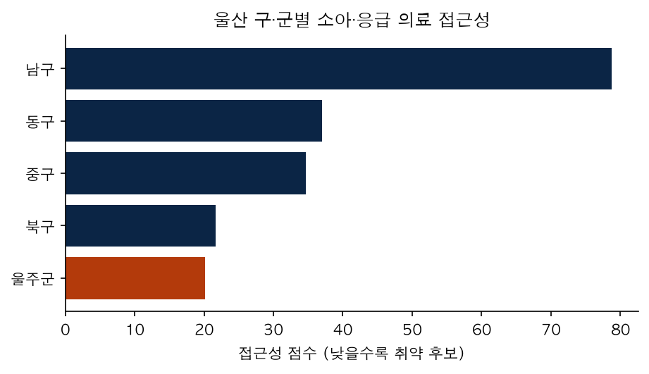
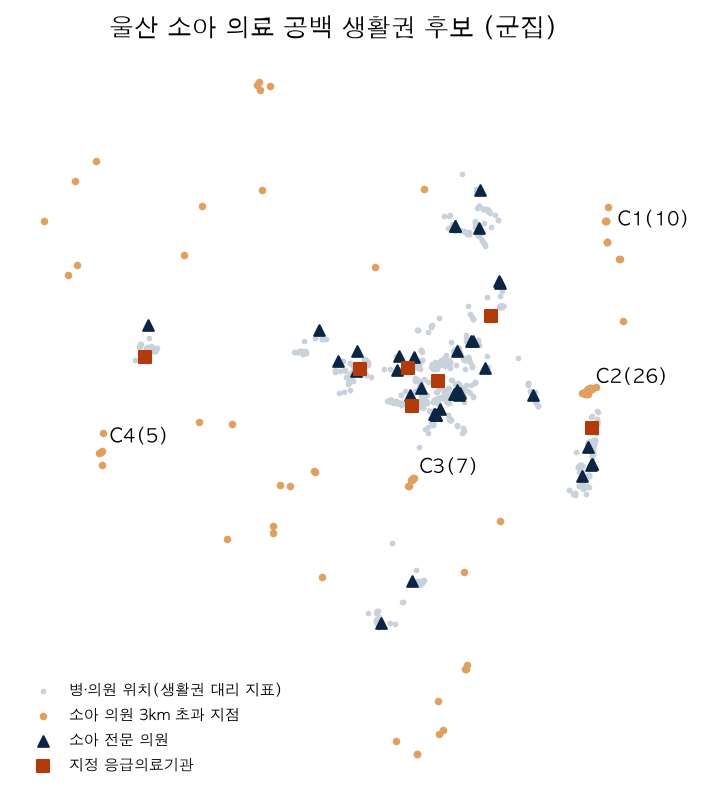
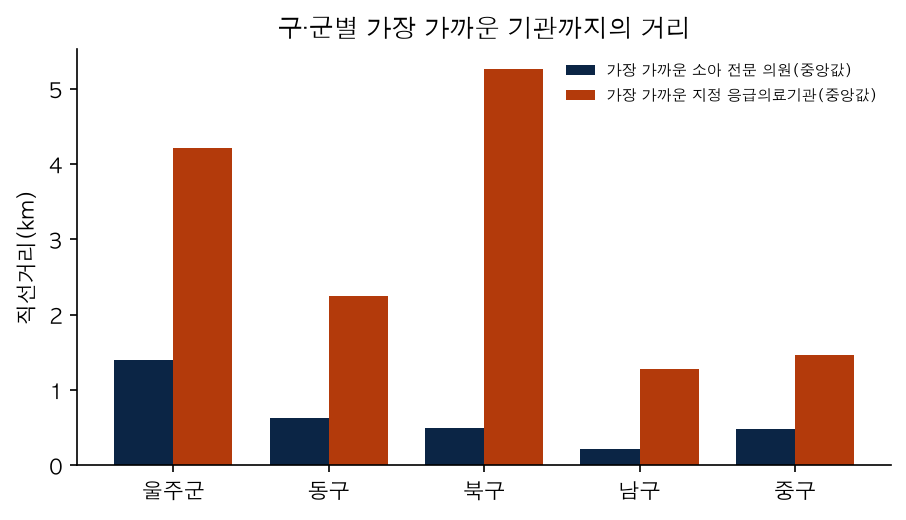

# 울산 응급·소아 필수의료 접근성 분석 + 로컬 실시간 병상 대시보드

> ⚠️ **학습·포트폴리오용 프로토타입입니다.** 의료·배차·환자 안내 결정에 쓰면 안 됩니다.
> 응급 상황에는 **119**에 신고하세요. 화면의 병상 수는 실제 수용 가능 여부를 보장하지 않으므로 방문 전 기관에 전화로 확인해야 합니다.

## 1. 프로젝트 소개

울산광역시의 지역별 소아·응급 필수의료 접근성 격차를 분석하고, 의료 취약 가능성이 있는 생활권을 파악하기 위해 진행한 데이터 분석 및 AI 활용 프로젝트입니다.
공공데이터를 활용하여 울산 지역 병·의원과 응급의료기관의 위치, 진료시간, 인구 정보를 분석하고, 지역별 의료기관 접근성 차이를 시각화했습니다.

## 2. 프로젝트 목적

- 울산 구·군별 소아·응급의료기관 접근성 비교
- 야간·휴일 소아 진료 공백 가능성이 있는 지역 탐색
- 의료 접근성이 낮은 생활권 후보 도출
- 응급실 가용 병상 정보를 확인할 수 있는 대시보드 구현
- 의료기관 추가 배치 가정에 따른 접근성 개선 시나리오 분석

## 3. 활용 기술 및 분석 방법

- Python, Pandas, NumPy를 활용한 데이터 수집 및 전처리
- 공공데이터 API를 활용한 의료기관 및 응급실 가용 병상 정보 수집
- Haversine 거리 계산을 통한 의료기관 접근성 분석
- DBSCAN 군집화를 활용한 의료 공백 후보 생활권 탐색
- 민감도 분석을 통한 후보 지역의 안정성 검토
- HTML, CSS, JavaScript 기반 분석 결과 대시보드 구현
- SQLite를 활용한 실시간 병상 관측 데이터 저장

## 4. 주요 분석 결과

울산 지역 의료기관 위치 자료를 활용하여 1,414개 지점을 분석했습니다. 소아의료기관까지의 거리와 응급의료기관까지의 거리 등을 비교하고, 군집화 및 민감도 분석을 수행했습니다.
분석 결과 울주군과 북구 일부 지역이 추가적인 현장 확인이 필요한 후보 지역으로 도출되었습니다.
또한 야간·휴일 소아 진료기관의 추가 배치를 가정한 거리 기반 시나리오 분석을 수행하고, 응급실 가용 병상 현황을 확인할 수 있는 웹 대시보드를 구현했습니다.

## 5. 프로젝트 결과물

- 울산 지역 의료 접근성 분석 결과
- 의료 공백 후보 지역 군집화 및 시각화
- 지역별 의료 접근성 비교 그래프
- 의료기관 추가 배치 가정 시나리오 분석
- 응급실 가용 병상 확인용 웹 대시보드
- 분석 및 서비스 구현 소스 코드

## 6. 기대효과 및 향후 발전 방향

지역별 필수의료 접근성 차이를 데이터로 파악하여 보건의료 정책 담당자의 추가 조사 및 현장 점검에 참고할 수 있는 기초자료를 제공하는 것을 목표로 합니다.
향후에는 더 긴 기간의 응급실 병상 관측 데이터를 확보하고, 실제 이동시간과 의료기관의 진료 역량 및 인구 수요를 추가 반영하여 분석의 신뢰도를 높일 계획입니다.

> ※ 본 프로젝트의 의료 취약지역은 거리와 기관 위치를 기준으로 도출한 추가 점검 후보이며, 실제 의료서비스 부족이나 건강 결과를 확정하는 것은 아닙니다. 병상 추세 역시 충분한 관측 기간을 확보하기 전까지 참고용으로만 활용합니다.

## 스크린샷

| 구·군별 접근성 점수 | 공백 생활권 후보(군집) | 가까운 기관까지 거리 |
|---|---|---|
|  |  |  |

## 무엇을 하나요

| 구성 | 방법 | 성격 |
|---|---|---|
| 접근성 점수 (`step3_access.py`) | 구·군별 소아·응급 기관 수를 인구 대비로 0~1 정규화해 평균 | 규칙 기반 통계, AI 아님 |
| 공백 생활권 탐지 (`step3b_gap_cluster.py`) | 병·의원 위치를 생활권 대리 지표로 쓰고, 소아 전문 의원이 3km 넘게 먼 지점을 DBSCAN으로 군집화 | 비지도 학습, 예측 모델 아님 |
| 현장 확인 우선순위 (`step3c_priority.py`) | 거리·군집 반경 9개 조합(민감도)에서 반복해서 나오는 후보만 표시 | 취약지역 "확정" 아님 |
| 개선 시나리오 (`step3d_scenario.py`) | 야간·휴일 소아 진료기관 1·3·5곳 추가를 가정한 직선거리 변화 | 가정 기반 계산, 실제 효과 아님 |
| 병상 경보 후향 검증 (`step6_alert_backtest.py`) | 과거 기록만으로 1·3시간 뒤 저병상(1석 이하) 진입 경보를 평가 | 기록 부족 시 성능 주장 불가 |
| 실시간 서버 (`server.py`) | API를 15분마다 수집해 SQLite에 저장, 로컬 화면에 표시 | `127.0.0.1` 전용 |

## 추가 참고: 실행 시점의 수치

- 울산 소아 전문 의원(기관명에 '소아' 포함) 39곳, 응급의료기관 13곳, 분석 지점 1,414곳
- 접근성 점수가 가장 낮게 나온 구·군: **울주군** (취약 *후보*이며 확정이 아님)
- 병상 경보 후향 검증: 관측이 약 3시간 19분뿐이라(기준: 최소 3일) 상태가 **`insufficient`**. 조기경보 성능을 주장하지 않습니다.
- 과거 병상 CSV의 울산 관측은 2023-12-12~13의 3개 시점뿐이라, 요일·시간대 혼잡 패턴과 AI 모델 비교는 보류했습니다.

## 한계 (중요)

- 소아 전문 의원은 기관명에 '소아'가 든 곳만 포함해 실제 소아 진료 가능 기관보다 적게 잡힙니다.
- 인구가 아니라 병·의원 위치를 수요의 대리 지표로 썼고, 도로·대중교통이 아닌 **직선거리**입니다. 3km·8km 기준은 임의값입니다.
- API 미응답 기관은 0병상이 아니라 "자료 미수신"입니다.
- 실시간 1·3시간 추세는 변화량 중앙값을 단순 외삽한 참고치이며 검증된 예측 모델이 아닙니다.
- 지역 현안 수치(공공의료기관 비중 등)는 시민단체 기고·언론 보도 기반이라 공식 통계 확인이 필요합니다.

## 실행 방법

### 1. 설치
```sh
git clone https://github.com/syyyyy96/ulsan-essential-care.git
cd ulsan-essential-care
python3 -m venv venv
source venv/bin/activate
pip install -r requirements.txt
```

### 2. 인증키 설정
공공데이터포털에서 아래 두 서비스를 활용신청(승인)한 뒤 일반 인증키(Decoding)를 받습니다.
- 국립중앙의료원_전국 병·의원 찾기 서비스
- 국립중앙의료원_전국 응급의료기관 정보 조회 서비스 / 응급의료정보 조회 서비스(실시간 병상)

```sh
cp .env.example .env
# .env 를 열어 키 입력
```

```
DATA_GO_KR_SERVICE_KEY=발급받은_키
```
(예전 이름 `DATA_GO_KR_KEY`도 읽지만 새로 만들 때는 위 이름 하나만 쓰세요.)
`.env`는 `.gitignore`에 들어 있어 커밋되지 않습니다. **키를 코드·이슈·스크린샷에 올리지 마세요.**

### 3. 분석 파이프라인
```sh
python check_setup.py            # 설치·키·자료 점검
python run_all.py                # 전체 실행 (step1에서 목록 내려받기 포함)
python run_all.py --demo         # 가짜 시험용 자료로 흐름만 확인 (제출·해석 금지)
```
원자료(`data/raw/`)는 저장소에 포함하지 않았으므로 step1이 API로 새로 내려받습니다. 인구 자료는 `data/raw/population_manual.csv`에 직접 입력합니다(행정안전부 주민등록 인구통계 또는 KOSIS).

### 4. 실시간 병상 대시보드 (로컬)
```sh
./run_dashboard.command          # macOS. 또는: python3 server.py
# 브라우저: http://127.0.0.1:8000/index.html
```
- 서버는 `127.0.0.1`에만 연결되며 다중 이용자 서비스가 아닙니다. 공개 서비스로 바꾸려면 접근통제·HTTPS·장애 감시·보안 검토·장기 예측 검증이 별도로 필요합니다.
- 지도 타일(OpenStreetMap 계열)과 Leaflet은 인터넷에서 불러옵니다.

## 폴더 구조

```
step1~6_*.py      분석 단계 (run_all.py 가 순서대로 실행)
content.py        대시보드·보고서가 함께 쓰는 본문 조각
common.py         경로, 키 읽기, 한글 폰트, 파일 읽기
server.py         실시간 수집·API 서버 (SQLite)
assets/           대시보드 CSS
outputs/          index.html(실시간 화면), charts/ (그래프)
START_HERE.md     상세 사용 안내
```
`data/`와 일부 `outputs/`는 실행하면 만들어지며 저장소에는 포함하지 않았습니다.

## 데이터 출처와 이용조건

| 자료 | 제공기관 | 이용허락범위 (공공데이터포털 표기) |
|---|---|---|
| 전국 병·의원 찾기 서비스 (Open API) | 국립중앙의료원 | 이용허락범위 제한 없음 |
| 전국 응급의료기관 정보 조회 서비스 (Open API, 실시간 병상 포함) | 국립중앙의료원 | 이용허락범위 제한 없음 |
| 응급의료기관 가용 병상·포화도 과거 CSV (`TB_NC_ICU_SCKBD_INFO.csv`) | 한국과학기술연구원(KIST) | 직접 확인 필요 (저장소에 미포함) |
| 울산 구·군별 인구 | 행정안전부 또는 KOSIS | 직접 확인 필요 (저장소에 미포함) |

- 이용허락범위는 각 서비스의 공공데이터포털 상세 페이지 표기를 기준으로 작성했으며, 포털 정책은 바뀔 수 있으니 사용 전에 다시 확인하세요.
- 이 저장소의 `outputs/index.html`에는 위 병·의원 서비스에서 받은 울산 의료기관의 **이름과 위치 좌표**가 들어 있습니다(전화번호는 없음). 전화번호·병상 값은 로컬 서버가 실행 중에 API로 받아 화면에 표시하며 저장소에는 포함되지 않습니다.
- 데이터 출처 표시: "국립중앙의료원, 공공데이터포털(data.go.kr)".

## 라이선스

코드: MIT (`LICENSE` 참고). 데이터는 위 출처의 이용조건을 따릅니다.
